# Grade 6 Science – Level H – Chapter 1
## Predicted Exam Questions: Sections 1.2 and 1.3

**Exam scope:** 1.2 *Classifying Organisms* and 1.3 *Heredity and Inheritance*
**Total:** 200 questions (100 per section) · every question has a **Hint**, an **Answer** and an **Explanation**
**Types:** MCQ · True/False · Find the Mistake · Written (short answer, tables, ordering, matching, key-reading)
**Pictures:** Some questions use a picture from the `images/` folder.
**Level tags:** *Medium* = a little harder than the book exercises. *Hard* = needs you to think and connect ideas.

---

# SECTION 1.2 – CLASSIFYING ORGANISMS (100 questions)

## Part A – Multiple Choice (Q1–Q36)

### Q1 · MCQ · LP1 · Medium
**Question:** Long ago, people thought whales were fish. Today, scientists classify whales with dogs. What changed?
A) Scientists found that whales have gills
B) Scientists studied body structures (lungs, live young, milk) and not only where the animal lives
C) Scientists decided that every animal living in water is a mammal
D) Whales changed their bodies over time

**Hint:** Think about *what* the scientists looked at.
**Answer:** B
**Explanation:** Whales live in water and have flippers, so they *looked* like fish. But whales have lungs, give birth to live young and feed them milk, just like dogs. Classification is based on similarities in body structures.

### Q2 · MCQ · LP1 · Medium
**Question:** Why is it useful that scientists all over the world use the same scientific name for an organism?
A) The names are shorter than common names
B) The names are always easier to say
C) It makes all organisms look the same
D) It avoids confusion when scientists in different places talk about the same organism

**Hint:** Imagine one animal that has three different names in three countries.
**Answer:** D
**Explanation:** Classifying and naming each kind of organism helps scientists in different parts of the world avoid confusion.

### Q3 · MCQ · LP1 · Medium
**Question:** Which sentence about classification is correct?
A) Scientists classify organisms using similarities in structures inside AND outside the body
B) Scientists classify organisms only by their color
C) Scientists classify organisms only by where they live
D) Classification is used only for animals

**Hint:** The word "inside" is important.
**Answer:** A
**Explanation:** Scientists look at structures inside and outside the body. Color or habitat alone can be misleading (for example, whales).

### Q4 · MCQ · LP1 · Hard
**Question:** A dolphin swims in the sea and has flippers, like a fish. Which feature shows that a dolphin is NOT a fish?
A) It lives in water
B) It has flippers
C) It breathes with lungs and feeds its young milk
D) It can swim fast

**Hint:** Fish breathe with gills. What do mammals use?
**Answer:** C
**Explanation:** Mammals (like whales and dolphins) have lungs and feed milk to their young. Living in water, swimming and having flippers are things a fish does too, so they do not prove anything.

### Q5 · MCQ · LP1 · Medium
**Question:** Which one is NOT a reason for classifying organisms?
A) To identify an unfamiliar organism
B) To make all organisms look similar
C) To find out if organisms are related to each other
D) To avoid confusion when naming organisms

**Hint:** Look for the choice that is impossible.
**Answer:** B
**Explanation:** Classification does not change how organisms look. It only arranges them into groups based on similarities.

### Q6 · MCQ · LP2 · Medium
**Question:** Why does every step of a dichotomous key have exactly TWO statements?
A) To make the key longer
B) Because there are only two kinds of organisms
C) To hide the name of the organism
D) So you can choose one statement that sends you to the organism or to the next step

**Hint:** "Di" means two. What do you do with two choices?
**Answer:** D
**Explanation:** In each step you choose the statement that matches your organism. It either names the organism or sends you to the next step.

### Q7 · MCQ · LP2 · Medium
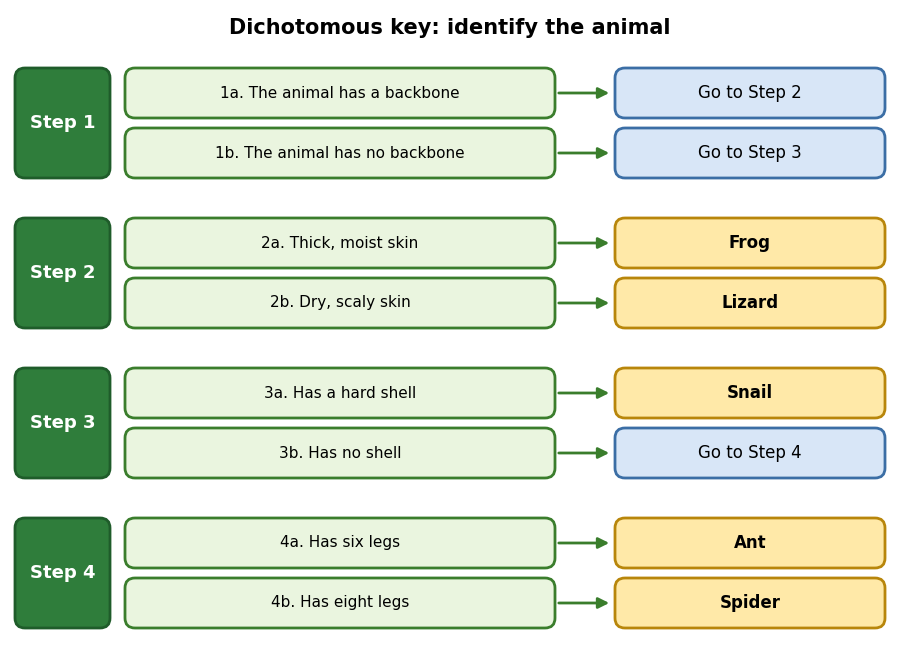
**Question:** Use the key in the picture. An animal has no backbone, has no shell and has six legs. Which animal is it?
A) Ant
B) Spider
C) Snail
D) Frog

**Hint:** Start at Step 1. Choose 1b, then follow the arrows.
**Answer:** A
**Explanation:** 1b (no backbone) → Step 3. 3b (no shell) → Step 4. 4a (six legs) → Ant.

### Q8 · MCQ · LP2 · Medium

**Question:** How many steps do you use to identify the spider with this key?
A) 1
B) 2
C) 3
D) 4

**Hint:** Write the path: Step 1 → ? → ?
**Answer:** C
**Explanation:** Spider: Step 1 (1b) → Step 3 (3b) → Step 4 (4b). That is 3 steps. (Step 2 is skipped.)

### Q9 · MCQ · LP2 · Hard

**Question:** A student finds an animal that has a backbone and hair. What happens when she uses this key?
A) She identifies a frog
B) The key cannot identify it, because no statement in Step 2 describes it
C) She identifies a lizard
D) She identifies a snail

**Hint:** Read Step 2 carefully. Does "hair" appear?
**Answer:** B
**Explanation:** Step 2 only has "thick, moist skin" and "dry, scaly skin". A key works only for the organisms it was made for.

### Q10 · MCQ · LP2 · Medium
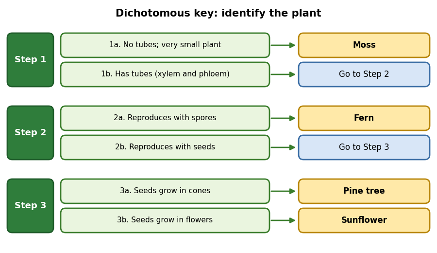
**Question:** Which characteristic separates the fern from the pine tree in this key?
A) The fern is smaller
B) The fern has tubes and the pine tree does not
C) The fern has leaves and the pine tree does not
D) The fern reproduces with spores and the pine tree reproduces with seeds

**Hint:** Both have tubes. Look at Step 2.
**Answer:** D
**Explanation:** In Step 2, spores lead to Fern and seeds lead to Step 3 (pine tree or sunflower). Both are vascular plants (they have tubes).

### Q11 · MCQ · LP2 · Medium
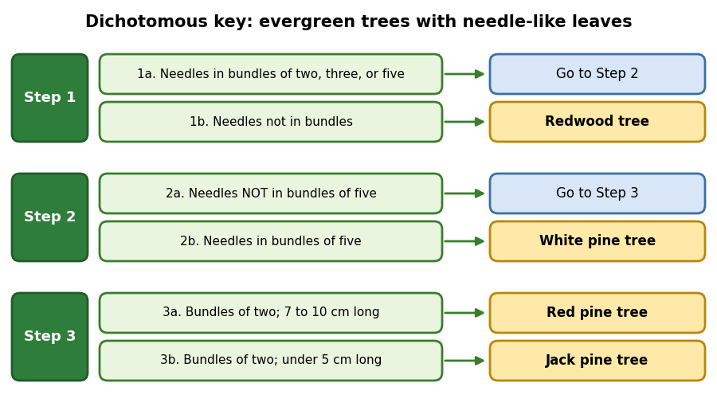
**Question:** A tree has needles in bundles of two. The needles are 4 cm long. Which tree is it?
A) Jack pine tree
B) Red pine tree
C) White pine tree
D) Redwood tree

**Hint:** Check the length in Step 3.
**Answer:** A
**Explanation:** Bundles → Step 2. Not five → Step 3. Two needles, under 5 cm → Jack pine tree.

### Q12 · MCQ · LP2 · Hard

**Question:** A tree has needles in bundles of THREE. What happens when you use this key?
A) It is a red pine tree
B) It is a Jack pine tree
C) The key cannot identify it, because neither statement in Step 3 fits
D) It is a redwood tree

**Hint:** Follow Step 1 → Step 2 → Step 3 and check each statement honestly.
**Answer:** C
**Explanation:** Three needles pass Step 1 and Step 2, but Step 3 only describes bundles of TWO. The key is not complete for this tree.

### Q13 · MCQ · LP3 · Medium
**Question:** Which list shows the levels of classification from the largest to the smallest?
A) Kingdom, Class, Phylum, Order, Family, Genus, Species
B) Kingdom, Phylum, Class, Order, Family, Genus, Species
C) Species, Genus, Family, Order, Class, Phylum, Kingdom
D) Phylum, Kingdom, Class, Order, Genus, Family, Species

**Hint:** One famous way to remember: **K**ing **P**hilip **C**ame **O**ver **F**or **G**ood **S**oup.
**Answer:** B
**Explanation:** The order is kingdom, phylum, class, order, family, genus, species. Each group is smaller than the one before.

### Q14 · MCQ · LP3 · Hard
**Question:** Two organisms belong to the same FAMILY. Which statement must be true?
A) They belong to the same species
B) They belong to the same genus
C) They belong to different kingdoms
D) They belong to the same kingdom, phylum, class and order

**Hint:** Family is a smaller group inside order, class, phylum and kingdom.
**Answer:** D
**Explanation:** Every smaller group sits inside the bigger ones. Organisms in the same family are also in the same order, class, phylum and kingdom. But they may be in different genera and species.

### Q15 · MCQ · LP3 · Hard
| Common name | Lion | Tiger | House cat |
|---|---|---|---|
| Family | Felidae | Felidae | Felidae |
| Genus | *Panthera* | *Panthera* | *Felis* |
| Species | *leo* | *tigris* | *catus* |

**Question:** Which statement is correct?
A) Lion and house cat are in the same genus
B) Lion and tiger are in the same genus but different species
C) All three animals are the same species
D) Tiger and house cat are in different families

**Hint:** Compare the genus row.
**Answer:** B
**Explanation:** Lion and tiger share the genus *Panthera* but have different species names. House cat has a different genus (*Felis*). All three share the family Felidae.

### Q16 · MCQ · LP3 · Medium
**Question:** The gray wolf is *Canis lupus* and the coyote is *Canis latrans*. What do they share?
A) The genus *Canis*
B) The species name
C) Both the genus and the species name
D) Nothing, they are not related

**Hint:** Which word is the genus: the first or the second?
**Answer:** A
**Explanation:** The first word is the genus (*Canis*), so they share a genus. The second words (*lupus*, *latrans*) are different, so they are different species.

### Q17 · MCQ · LP3 · Medium
**Question:** Which scientific name of the tiger is written correctly?
A) *panthera tigris*
B) *Panthera Tigris*
C) *Panthera tigris*
D) *PANTHERA tigris*

**Hint:** Only one word starts with a capital letter.
**Answer:** C
**Explanation:** The genus name (first word) starts with a capital letter. The species name (second word) is all lowercase. The whole name is written in italics.

### Q18 · MCQ · LP3 · Hard
**Question:** Two groups of birds look almost the same, but they cannot reproduce with each other. What does this suggest?
A) They are the same species
B) They are the same individual
C) They are the same genus only because they look alike
D) They are probably different species

**Hint:** Remember the definition of a species.
**Answer:** D
**Explanation:** A species is a group of organisms so closely related that they can reproduce with each other. If two groups cannot, they are probably different species.

### Q19 · MCQ · LP3 · Medium
**Question:** A gorilla and a butterfly are both in the animal kingdom, but they are NOT closely related. Why?
A) A kingdom is a very large group, so its members share only some characteristics
B) A gorilla is not an animal
C) The kingdom is the smallest group
D) A butterfly is a plant

**Hint:** Think about how big a kingdom is.
**Answer:** A
**Explanation:** Organisms in the same kingdom may not be closely related. Closer relatives are found in smaller groups such as genus and species.

### Q20 · MCQ · LP3 · Medium
**Question:** Today, scientists classify organisms into ___ kingdoms and ___ levels.
A) 5 and 6
B) 6 and 6
C) 6 and 7
D) 7 and 6

**Hint:** Do not mix them up: kingdoms ≠ levels.
**Answer:** C
**Explanation:** There are six kingdoms. Classification has seven levels (kingdom to species).

### Q21 · MCQ · LP4 · Medium
**Question:** Which one is NOT a characteristic of ALL plants?
A) They are multicellular
B) They produce flowers
C) They use sunlight to make food
D) They cannot move from place to place

**Hint:** Think about moss and horsetail.
**Answer:** B
**Explanation:** Not all plants have flowers (mosses and ferns do not). All plants are multicellular, make food by photosynthesis and stay in one place.

### Q22 · MCQ · LP4 · Hard
**Question:** A vine wraps its stem around a fence post. Which statement is correct?
A) It is an animal because it moves
B) It is walking from one place to another
C) It is a nonvascular plant because it is thin
D) It is a plant; it grows toward or around objects but does not move from place to place

**Hint:** Growing is not the same as moving to a new place.
**Answer:** D
**Explanation:** Plants cannot move from one place to another, but they can grow toward light and water, and some support themselves by wrapping around objects.

### Q23 · MCQ · LP4 · Medium
**Question:** Why are nonvascular plants usually very small?
A) They have no tubes, so materials move directly between cells
B) They cannot make food
C) They have too many tubes
D) They are animals

**Hint:** Think about how far water must travel.
**Answer:** A
**Explanation:** Without tubes, water and food can only move from cell to cell. This works only over very short distances, so the plant stays small.

### Q24 · MCQ · LP4 · Hard
**Question:** A moss plant is only a few cells thick. How does this help it live without a vascular system?
A) It does not need food
B) Food, water and wastes can pass directly from cell to cell
C) It reproduces by seeds
D) It has a backbone

**Hint:** Thin plant = short distance.
**Answer:** B
**Explanation:** Because moss is so thin, materials do not travel far. They can pass directly between the cells.

### Q25 · MCQ · LP4 · Medium
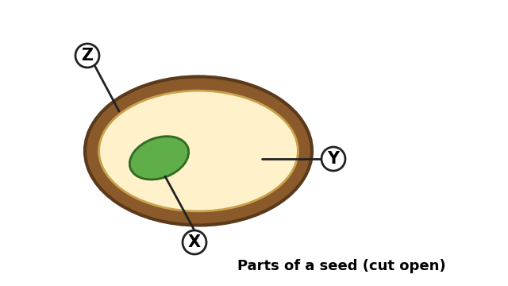
**Question:** Which letter shows the part that will grow into a new plant?
A) Y
B) Z
C) X
D) None of them

**Hint:** The embryo is a small developing plant. It is green in the picture.
**Answer:** C
**Explanation:** X is the embryo. Y is the food supply and Z is the seed coat that protects the seed.

### Q26 · MCQ · LP4 · Hard
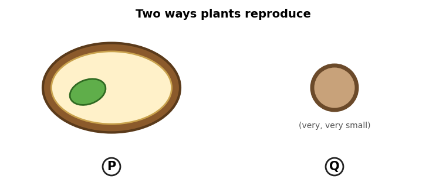
**Question:** Which picture shows a spore, and why?
A) P, because it contains an embryo
B) P, because it is very small
C) Q, because it contains stored food
D) Q, because it is a tiny reproductive cell with no embryo and no stored food

**Hint:** Compare what is inside P and Q.
**Answer:** D
**Explanation:** A seed (P) has a coat, an embryo and a food supply. A spore (Q) has a protective coating but no embryo and no stored food.

### Q27 · MCQ · LP4 · Medium
**Question:** A gardener plants bean seeds in dry soil during very cold weather. Nothing grows. Which two conditions were missing?
A) Sunlight and soil
B) Water and a suitable temperature
C) Wind and spores
D) A seed coat and an embryo

**Hint:** What does a seed need to sprout?
**Answer:** B
**Explanation:** A seed sprouts when water becomes available and the temperature is suitable.

### Q28 · MCQ · LP4 · Medium
**Question:** Which pair of plants BOTH reproduce with spores?
A) Moss and fern
B) Fern and pine tree
C) Pine tree and sunflower
D) Moss and sunflower

**Hint:** Conifers and flowering plants use seeds.
**Answer:** A
**Explanation:** Mosses and ferns reproduce with spores. Conifers (like pine) and flowering plants (like sunflower) reproduce with seeds.

### Q29 · MCQ · LP5 · Medium
**Question:** A lion must hunt, but a tree does not. Which statement explains this?
A) A tree is bigger than a lion
B) A lion has a backbone
C) Plant cells have chloroplasts to make food using sunlight, but animal cells do not
D) A tree can move to find food

**Hint:** Who makes their own food?
**Answer:** C
**Explanation:** Plants make food by photosynthesis. Animals get energy by eating other organisms.

### Q30 · MCQ · LP5 · Medium
**Question:** Which group contains ONLY vertebrates?
A) Fish, birds, snails
B) Reptiles, amphibians, mammals
C) Insects, spiders, crabs
D) Birds, crabs, frogs

**Hint:** Cross out any group with an animal that has no backbone.
**Answer:** B
**Explanation:** Snails, insects, spiders and crabs are invertebrates. Reptiles, amphibians and mammals all have backbones.

### Q31 · MCQ · LP5 · Medium
**Question:** Which structure supports a vertebrate's body and grows larger as the animal grows?
A) Shell
B) Carapace
C) Antennae
D) Internal skeleton

**Hint:** Vertebrates have it inside the body.
**Answer:** D
**Explanation:** The internal skeleton (including the backbone) supports the animal and grows as the animal grows.

### Q32 · MCQ · LP5 · Hard
**Question:** Why are most invertebrates small?
A) They have no internal skeleton to support a large body
B) They cannot eat other organisms
C) They have backbones that are too short
D) They live only in water

**Hint:** What supports a big body?
**Answer:** A
**Explanation:** Because invertebrates have no internal skeleton for support, most of them are small. They use hard coverings or shells.

### Q33 · MCQ · LP5 · Hard
**Question:** Insects shed their hard outside covering as they grow. What does this suggest?
A) The covering is alive and grows with the insect
B) Insects have an internal skeleton
C) The hard covering does not grow, so the insect needs a new, bigger one
D) Insects are vertebrates

**Hint:** Can a hard shell stretch?
**Answer:** C
**Explanation:** The hard covering cannot get bigger, so the insect sheds it as it grows. Remember: insects are invertebrates and use a hard outer covering for support.

### Q34 · MCQ · LP5 · Medium
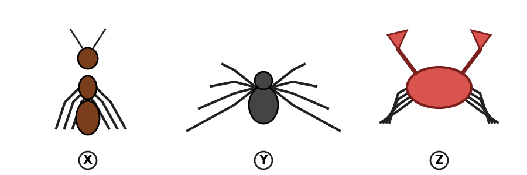
**Question:** Look at the picture. Which animal is an insect?
A) Y
B) X
C) Z
D) None of them

**Hint:** Count the legs. Insects have six.
**Answer:** B
**Explanation:** X has six legs and two antennae, so it is an insect. Y has eight legs (spider). Z has pincers and a hard carapace (crab).

### Q35 · MCQ · LP5 · Hard

**Question:** What do X, Y and Z all have in common?
A) Six legs
B) A backbone
C) An internal skeleton
D) No backbone; they support their bodies with hard coverings

**Hint:** Which group do ants, spiders and crabs belong to?
**Answer:** D
**Explanation:** All three are invertebrates. Invertebrates have no backbone and use hard coverings or shells for support.

### Q36 · MCQ · LP5 · Medium
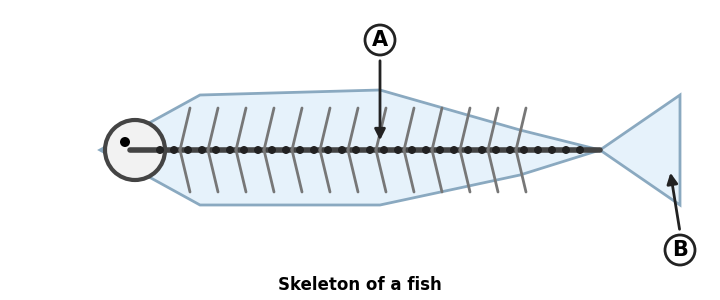
**Question:** What is part A, and what group does this fish belong to?
A) The backbone; vertebrates
B) The backbone; invertebrates
C) A shell; vertebrates
D) A carapace; invertebrates

**Hint:** Look at the long line of small bones.
**Answer:** A
**Explanation:** A is the backbone, part of the internal skeleton. An animal with a backbone is a vertebrate.

---
## Part B – True or False (Q37–Q60)
*(If the statement is false, correct it.)*

### Q37 · True/False · LP1 · Medium
**Statement:** Scientists classify organisms by looking at similarities in body structures, both inside and outside the body.
**Hint:** Think about the whale and the dog.
**Answer:** True
**Explanation:** Classification is based on similarities in structures inside and outside the body.

### Q38 · True/False · LP1 · Medium
**Statement:** A whale is classified as a fish because it lives in water and has flippers.
**Hint:** What do whales feed their young?
**Answer:** False. A whale is classified as a mammal.
**Explanation:** Whales have lungs, give birth to live young and feed them milk. Living in water is not enough to make an animal a fish.

### Q39 · True/False · LP1 · Medium
**Statement:** Two scientists in different countries can use the same scientific name to talk about the same organism.
**Hint:** Why do scientists name organisms?
**Answer:** True
**Explanation:** Scientific naming helps scientists in different parts of the world avoid confusion.

### Q40 · True/False · LP2 · Medium
**Statement:** In a dichotomous key, each step can have three or four statements.
**Hint:** "Di" means…?
**Answer:** False. Each step has exactly two statements.
**Explanation:** "Di" means two. You choose one of the two statements in each step.

### Q41 · True/False · LP3 · Medium
**Statement:** All animals in the animal kingdom are closely related to each other.
**Hint:** Remember the gorilla and the butterfly.
**Answer:** False
**Explanation:** A kingdom is a very large group. Its members share some characteristics, but may not be closely related.

### Q42 · True/False · LP3 · Hard
**Statement:** If two organisms are in the same genus, they must also be in the same family.
**Hint:** Is a genus bigger or smaller than a family?
**Answer:** True
**Explanation:** Genus is a smaller group inside family. Organisms in the same genus are also in the same family, order, class, phylum and kingdom.

### Q43 · True/False · LP3 · Hard
**Statement:** If two organisms are in the same order, they must be in the same family.
**Hint:** Which group is bigger, order or family?
**Answer:** False
**Explanation:** Order is a bigger group than family. Two organisms in the same order can be in different families. (For example, bears and wolves are both in order Carnivora but in different families.)

### Q44 · True/False · LP3 · Medium
**Statement:** The species is the smallest group, so organisms in the same species are the most closely related.
**Hint:** Smaller group = more related.
**Answer:** True
**Explanation:** As you move down the levels, each group is smaller and the organisms are more closely related.

### Q45 · True/False · LP3 · Medium
**Statement:** In the scientific name *Ursus arctos*, the word *arctos* is the genus.
**Hint:** Which word comes first?
**Answer:** False. *Ursus* is the genus and *arctos* is the species.
**Explanation:** The first word is the genus name and the second word is the species name.

### Q46 · True/False · LP4 · Medium
**Statement:** A vine wrapping around a pole proves that plants can move from one place to another.
**Hint:** Wrapping is growth.
**Answer:** False
**Explanation:** Plants cannot move from one place to another. They can only grow toward light and water, or around objects.

### Q47 · True/False · LP4 · Medium
**Statement:** Vascular plants have tubes called xylem and phloem that transport water, minerals and food.
**Hint:** Think "vascular system".
**Answer:** True
**Explanation:** Xylem and phloem make up the vascular system.

### Q48 · True/False · LP4 · Hard
**Statement:** A very tall tree is more likely to be a nonvascular plant than a vascular plant.
**Hint:** How can water reach the top of a tall tree?
**Answer:** False
**Explanation:** Nonvascular plants are usually very small because materials only move from cell to cell. A tall plant needs tubes to carry water and food to all its parts.

### Q49 · True/False · LP4 · Medium
**Statement:** A seed has a seed coat, an embryo and a food supply.
**Hint:** Look at the seed diagram.
**Answer:** True
**Explanation:** The seed coat protects. The embryo is a small developing plant. The food supply feeds the embryo.

### Q50 · True/False · LP4 · Medium
**Statement:** A spore contains an embryo and stored food.
**Hint:** Compare seed and spore.
**Answer:** False
**Explanation:** A spore has a protective coating but no embryo and no stored food.

### Q51 · True/False · LP4 · Medium
**Statement:** Ferns reproduce with spores.
**Hint:** Spores or seeds?
**Answer:** True
**Explanation:** Mosses and ferns reproduce with spores.

### Q52 · True/False · LP5 · Medium
**Statement:** Animals get energy by eating other organisms or substances made by other organisms.
**Hint:** Can animals make their own food?
**Answer:** True
**Explanation:** Animals cannot make food by photosynthesis. They must eat other organisms or things other organisms make.

### Q53 · True/False · LP3 · Hard
**Statement:** Elephants and ostriches both belong to phylum Chordata. Elephants and cats both belong to class Mammalia. So elephants are more closely related to cats than to ostriches.
**Hint:** Which shared group is smaller: phylum or class?
**Answer:** True
**Explanation:** Class is a smaller group than phylum. Sharing a smaller group means being more closely related.

### Q54 · True/False · LP3 · Hard
**Statement:** A human (phylum Chordata) and a sand crab (phylum Arthropoda) belong to the same phylum.
**Hint:** Compare the two phylum names.
**Answer:** False
**Explanation:** They have different phyla. They only share the kingdom Animalia.

### Q55 · True/False · LP5 · Medium
**Statement:** Reptiles have dry, scaly skin, while amphibians have thick, moist skin.
**Hint:** Think about a lizard and a frog.
**Answer:** True
**Explanation:** This is one way to tell these two groups of vertebrates apart.

### Q56 · True/False · LP5 · Hard
**Statement:** A spider is an insect because it is an invertebrate with legs.
**Hint:** Count the legs.
**Answer:** False
**Explanation:** Insects have six legs and two antennae. Spiders have eight legs. Both are invertebrates, but they are different groups.

### Q57 · True/False · LP5 · Medium
**Statement:** A crab's carapace is a hard covering that supports its body.
**Hint:** Crabs have no backbone.
**Answer:** True
**Explanation:** Invertebrates support their bodies with hard coverings or shells. A crab's hard covering is called a carapace.

### Q58 · True/False · LP5 · Medium
**Statement:** All mammals are vertebrates, but not all vertebrates are mammals.
**Hint:** Think of a fish.
**Answer:** True
**Explanation:** Vertebrates include fish, birds, reptiles, amphibians and mammals. Mammals are only one group of them.

### Q59 · True/False · LP5 · Medium
**Statement:** An animal with no backbone always has a large internal skeleton.
**Hint:** What does "invertebrate" mean?
**Answer:** False
**Explanation:** Animals with no backbone (invertebrates) have no internal skeleton. They use hard coverings or shells.

### Q60 · True/False · LP5 · Hard
**Statement:** Hollow, lightweight bones help a bird to fly.
**Hint:** Is a lighter bird easier or harder to lift?
**Answer:** True
**Explanation:** Hollow bones make the bird light. Wings lift the bird from the ground, so flying is easier.

---

## Part C – Find the Mistake (Q61–Q80)
*(Find the mistake and write the correct answer.)*

### Q61 · Find the Mistake · LP3 · Medium
**Student's answer:** "The scientific name of the tiger is *panthera Tigris*."
**Hint:** Look at the capital letters.
**Mistake:** The capital letter is on the wrong word.
**Correct answer:** *Panthera tigris*
**Explanation:** The genus (first word) begins with a capital letter. The species (second word) is all lowercase.

### Q62 · Find the Mistake · LP3 · Medium
**Student's answer:** "The levels from largest to smallest are: kingdom, phylum, class, family, order, genus, species."
**Hint:** Two levels are swapped.
**Mistake:** Family and order are in the wrong places.
**Correct answer:** kingdom, phylum, class, **order, family**, genus, species.
**Explanation:** Order is bigger than family.

### Q63 · Find the Mistake · LP3 · Medium
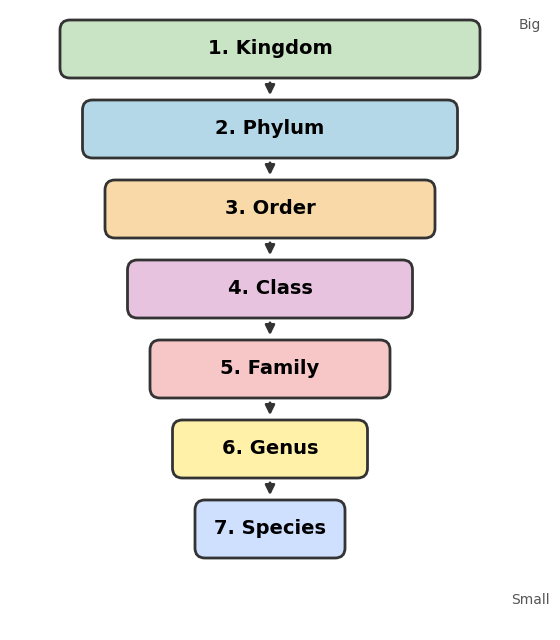
**Question:** The picture shows the levels of classification from big to small. One mistake is hidden. Find it.
**Hint:** Read the numbers 1 to 7 slowly and compare with the correct order.
**Mistake:** Order (3) and Class (4) are swapped.
**Correct answer:** 3. Class, 4. Order.
**Explanation:** The correct order is Kingdom, Phylum, Class, Order, Family, Genus, Species.

### Q64 · Find the Mistake · LP1 · Medium
**Student's answer:** "Whales are fish because they live in water, swim and have flippers."
**Hint:** Which body structures matter?
**Mistake:** Whales are not fish.
**Correct answer:** Whales are mammals. They have lungs, give birth to live young and feed them milk.
**Explanation:** Scientists classify by body structures, not only by where an animal lives.

### Q65 · Find the Mistake · LP2 · Medium
**Student's answer:** "The prefix *di* means three, so a dichotomous key has three statements in each step."
**Hint:** What does "di" mean?
**Mistake:** The meaning of "di".
**Correct answer:** "Di" means two, so each step has two statements.
**Explanation:** You choose one of the two statements in each step.

### Q66 · Find the Mistake · LP4 · Hard
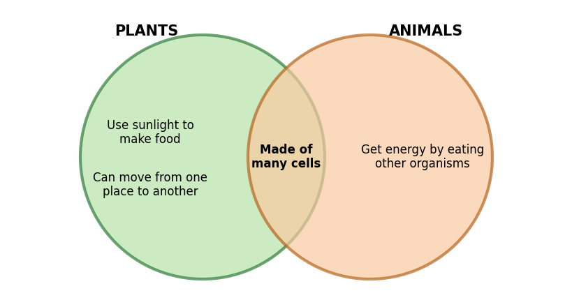
**Question:** Find the mistake in the Venn diagram.
**Hint:** Can plants move from one place to another?
**Mistake:** "Can move from one place to another" is written under PLANTS.
**Correct answer:** It belongs under ANIMALS (plants cannot move from place to place).
**Explanation:** Plants make food using sunlight but stay in one place. Animals eat other organisms and can move. Both are multicellular.

### Q67 · Find the Mistake · LP3 · Medium
**Student's answer:** "A gorilla and a butterfly are both animals, so they are closely related."
**Hint:** Is "kingdom" a big or small group?
**Mistake:** Being in the same kingdom does not mean being closely related.
**Correct answer:** They are in the same kingdom, but they are not closely related.
**Explanation:** Organisms are more closely related when they share smaller groups such as family, genus or species.

### Q68 · Find the Mistake · LP3 · Hard
**Student's answer:** "Bears and wolves are both in the order Carnivora, so they are in the same family."
**Hint:** Which is bigger, order or family?
**Mistake:** Same order does not mean same family.
**Correct answer:** Bears and wolves are in the same order but in different families (Ursidae and Canidae).
**Explanation:** Order is a bigger group than family. Sharing a bigger group tells us less.

### Q69 · Find the Mistake · LP4 · Medium
**Student's answer:** "Nonvascular plants can grow very tall because they have xylem and phloem."
**Hint:** What does "nonvascular" mean?
**Mistake:** Nonvascular plants have no tubes.
**Correct answer:** Nonvascular plants are usually very small. They move materials directly between cells.
**Explanation:** Xylem and phloem belong to vascular plants.

### Q70 · Find the Mistake · LP4 · Medium
**Student's answer:** "A spore is a small seed that has an embryo and a food supply."
**Hint:** What does a spore lack?
**Mistake:** A spore is not a seed and does not have an embryo or food.
**Correct answer:** A spore is a small reproductive cell with a protective coating. It has no embryo and no stored food.
**Explanation:** Only a seed has an embryo and a food supply.

### Q71 · Find the Mistake · LP4 · Medium
**Student's answer:** "The embryo is the part that protects the seed."
**Hint:** What does the seed coat do?
**Mistake:** The embryo does not protect the seed.
**Correct answer:** The **seed coat** protects the seed. The embryo is a small developing plant.
**Explanation:** The three parts are the seed coat (protects), the embryo (grows into a plant) and the food supply (feeds the embryo).

### Q72 · Find the Mistake · LP4 · Medium
**Student's answer:** "All plants reproduce with seeds, for example moss and ferns."
**Hint:** Which plants use spores?
**Mistake:** Moss and ferns do not use seeds.
**Correct answer:** Plants reproduce by seeds or spores. Moss and ferns use spores. Conifers and flowering plants use seeds.
**Explanation:** Two ways of reproducing exist in plants.

### Q73 · Find the Mistake · LP5 · Medium
**Student's answer:** "Animals make their own food because their cells have chloroplasts."
**Hint:** Which cells have chloroplasts?
**Mistake:** Animal cells do not have chloroplasts.
**Correct answer:** Plant cells have chloroplasts and make food. Animals get energy by eating other organisms.
**Explanation:** Chloroplasts use sunlight to make food (photosynthesis).

### Q74 · Find the Mistake · LP5 · Medium
**Student's answer:** "A vertebrate is an animal without a backbone, such as a frog."
**Hint:** "Vertebra" is a bone in the backbone.
**Mistake:** A vertebrate HAS a backbone.
**Correct answer:** A vertebrate is an animal with a backbone, such as a frog. An animal without a backbone is an invertebrate.
**Explanation:** The backbone is part of the internal skeleton.

### Q75 · Find the Mistake · LP5 · Medium
**Student's answer:** "Insects have eight legs, so spiders and insects are the same group."
**Hint:** Count the legs of an ant and a spider.
**Mistake:** Insects have six legs, not eight.
**Correct answer:** Insects have six legs and two antennae. Spiders have eight legs, so they are a different group.
**Explanation:** Both are invertebrates but they are different groups.

### Q76 · Find the Mistake · LP2 · Hard

**Student's answer:** "I found a tree with needles in bundles of two. They are 4 cm long. It is a red pine tree."
**Hint:** Check the needle length in Step 3.
**Mistake:** The tree is not a red pine.
**Correct answer:** It is a Jack pine tree (under 5 cm). Red pine needles are 7 to 10 cm long.
**Explanation:** Step 3 separates the two trees by needle length.

### Q77 · Find the Mistake · LP2 · Hard

**Student's answer:** "I identified the ant like this: Step 1 → 1b, Step 3 → 3a, Step 4 → 4a."
**Hint:** Does an ant have a hard shell?
**Mistake:** Step 3 should be 3b, not 3a.
**Correct answer:** Step 1 → 1b, Step 3 → **3b** (no shell), Step 4 → 4a (six legs) = Ant.
**Explanation:** 3a leads to Snail, because it has a hard shell. An ant has no shell.

### Q78 · Find the Mistake · LP3 · Hard
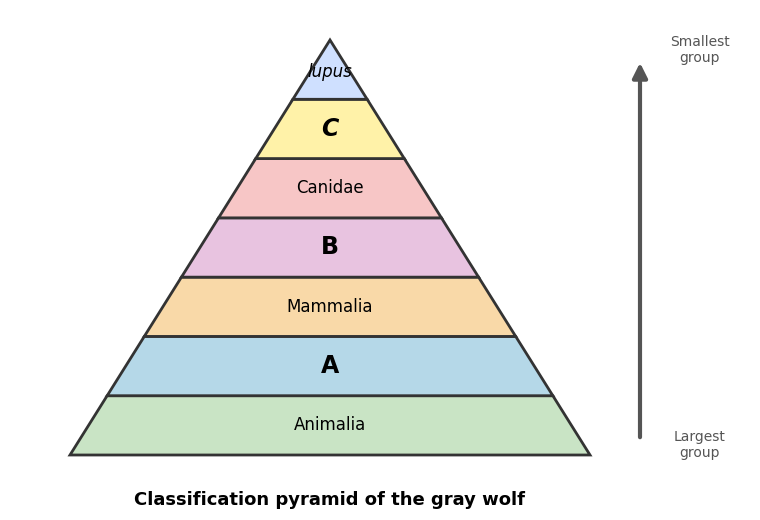
**Student's answer:** "A is the class, B is the order and C is the genus."
**Hint:** Class is already written in the pyramid (Mammalia).
**Mistake:** A is not the class.
**Correct answer:** A = phylum, B = order, C = genus.
**Explanation:** The pyramid goes from the largest group (kingdom) to the smallest (species). The second level is the phylum.

### Q79 · Find the Mistake · LP3 · Hard
**Student's answer:** "Elephants and ostriches share a phylum (Chordata). Elephants and cats share a class (Mammalia). So elephants are more closely related to ostriches."
**Hint:** Which group is smaller, phylum or class?
**Mistake:** The conclusion is wrong.
**Correct answer:** Elephants are more closely related to cats.
**Explanation:** Class is smaller than phylum. The smaller the shared group, the closer the relationship.

### Q80 · Find the Mistake · LP4 · Medium

**Student's answer:** "Y is the seed coat and X is the food supply."
**Hint:** The embryo is green.
**Mistake:** The labels are wrong.
**Correct answer:** Z is the seed coat, Y is the food supply and X is the embryo.
**Explanation:** The seed coat is the outside layer, the food supply is inside it, and the embryo is the small developing plant.

---

## Part D – Written Questions (Q81–Q100)

### Q81 · Written · LP1 · Medium
**Question:** Give two reasons why classification is useful. Use the whale as an example for one of them.
**Hint:** One reason is about unfamiliar organisms, the other is about relationships.
**Model answer:** (1) Classification helps scientists identify an unfamiliar organism. (2) It helps scientists find out if organisms are related to each other. Example: whales look like fish, but classification shows they are mammals, related to dogs, because they have lungs, live young and milk. (Also: it avoids confusion when naming organisms.)
**Explanation:** Any two correct reasons earn the marks. A clear example shows understanding.

### Q82 · Written · LP2 · Medium
**Question:** What is a dichotomous key? Explain how you use it.
**Hint:** Say how many statements there are in each step.
**Model answer:** A dichotomous key is a tool used to identify organisms based on their characteristics. It is arranged in steps. Each step has two statements. You choose the one that matches your organism. It either names the organism or sends you to the next step.
**Explanation:** "Di" means two. Key ideas: steps, two statements, identify or go on.

### Q83 · Written · LP3 · Medium
**Question:** Order these levels from the LARGEST (1) to the SMALLEST (7): Genus, Class, Species, Kingdom, Family, Phylum, Order. Then say which level has the most closely related organisms.
**Hint:** Use a memory sentence.
**Model answer:** 1 Kingdom, 2 Phylum, 3 Class, 4 Order, 5 Family, 6 Genus, 7 Species. Species has the most closely related organisms.
**Explanation:** Each group is smaller than the one before. Organisms in the same species can reproduce with each other.

### Q84 · Written · LP3 · Hard
| Level | Polar bear |
|---|---|
| Kingdom | Animalia |
| Phylum | Chordata |
| Class | Mammalia |
| Order | **A** |
| Family | Ursidae |
| Genus | **B** |
| Species | *maritimus* |

**Question:** (a) Fill in A and B. (b) Write the full scientific name of the polar bear. (c) The brown bear is *Ursus arctos*. Which levels do the polar bear and the brown bear share? Why are they different species?
**Hint:** The genus is the first word of the scientific name of the brown bear, and bears are carnivores.
**Model answer:** (a) A = Carnivora, B = *Ursus*. (b) *Ursus maritimus*. (c) They share kingdom, phylum, class, order, family and genus. They are different species (*maritimus* ≠ *arctos*).
**Explanation:** The two bears share all levels down to genus, so they are very closely related. They have different species names, so they are different species.

### Q85 · Written · LP3 · Hard
| | Lion | Tiger | House cat |
|---|---|---|---|
| Order | Carnivora | Carnivora | Carnivora |
| Family | Felidae | Felidae | Felidae |
| Genus | *Panthera* | *Panthera* | *Felis* |
| Species | *leo* | *tigris* | *catus* |

**Question:** Which two animals are the most closely related? Explain, using the table.
**Hint:** Find the smallest group they share.
**Model answer:** Lion and tiger. They share the same genus (*Panthera*), which is a smaller group than the family. The house cat shares only the family (and bigger groups) with them.
**Explanation:** The smaller the group two organisms share, the more related they are.

### Q86 · Written · LP4 · Medium
**Question:** Compare vascular and nonvascular plants. Write two differences and give one example of a nonvascular plant.
**Hint:** Think tubes and size.
**Model answer:** Vascular plants have tubes (xylem and phloem) that carry water, minerals and food. Nonvascular plants have no tubes; they move materials directly between cells. Nonvascular plants are usually very small. Example: moss.
**Explanation:** Differences: tubes vs no tubes, size, and how materials move.

### Q87 · Written · LP4 · Hard
**Question:** Write two differences and one similarity between a seed and a spore.
**Hint:** What is inside a seed? What is the job of both?
**Model answer:** Differences: A seed has an embryo and a food supply; a spore has neither. A seed has a seed coat around it; a spore has only a small protective coating. Similarity: both are used by plants to reproduce and can grow into a new plant.
**Explanation:** A spore is a small reproductive cell. A seed is a larger structure with an embryo and food.

### Q88 · Written · LP4 · Hard
**Question:** Infer: Why do you think a seed needs a food supply next to the embryo?
**Hint:** A new baby plant is very small. What does it need before it can make food?
**Model answer:** The embryo is a tiny developing plant. It needs food to begin to grow until it can make its own food using sunlight. The food supply feeds it.
**Explanation:** This connects the seed parts to plant needs.

### Q89 · Written · LP5 · Medium
**Question:** Explain why plants make their own food, but animals must eat other organisms.
**Hint:** Think about chloroplasts and sunlight.
**Model answer:** Plant cells have chloroplasts. Chloroplasts use sunlight to make food (photosynthesis). Animal cells do not have chloroplasts, so animals get their energy by eating other organisms.
**Explanation:** The key word is *chloroplasts*.

### Q90 · Written · LP5 · Medium
**Question:** Put these animals in the correct group: frog, snail, lizard, eagle, crab, spider, goldfish, ant, scorpion, dog. Then write one feature of each group.
**Hint:** Does the animal have a backbone?
**Model answer:** Vertebrates: frog, lizard, eagle, goldfish, dog (they have a backbone and an internal skeleton). Invertebrates: snail, crab, spider, ant, scorpion (no backbone; hard coverings or shells).
**Explanation:** Fish, birds, reptiles, amphibians and mammals are vertebrates.

### Q91 · Written · LP5 · Hard
**Question:** (a) Why are most invertebrates small? (b) How do they support their bodies? (c) Give two examples.
**Hint:** What do vertebrates have inside that invertebrates do not?
**Model answer:** (a) They have no internal skeleton to support a big body. (b) They use hard coverings or shells. (c) Any two: insects, snails, spiders, crabs, scorpions.
**Explanation:** Support is the problem and hard coverings are the solution.

### Q92 · Written · LP5 · Hard
**Question:** A bird has wings and hollow bones with many holes. Explain how each feature helps the bird fly.
**Hint:** One feature lifts, the other reduces weight.
**Model answer:** Wings let the bird lift itself from the ground. Hollow bones make the bird's body light, so it is easier to fly.
**Explanation:** Structures are adapted to how an animal lives.

### Q93 · Written · LP5 · Hard
**Question:** A scientist finds a new animal. It has a backbone and dry, scaly skin. Is it a vertebrate or an invertebrate? Which group of vertebrates is it most like? Explain.
**Hint:** Compare the skin of reptiles and amphibians.
**Model answer:** It is a vertebrate because it has a backbone. It is most like a reptile, because reptiles have dry, scaly skin (amphibians have moist skin).
**Explanation:** Use two clues: backbone, then skin type.

### Q94 · Written · LP2 · Hard

**Question:** Use the key. Identify these plants: (a) a very small plant with no tubes, (b) a plant with tubes that reproduces with spores, (c) a plant with tubes whose seeds grow in flowers. Write the steps you used for (c).
**Hint:** Start at Step 1 every time.
**Model answer:** (a) Moss. (b) Fern. (c) Sunflower: Step 1 → 1b; Step 2 → 2b; Step 3 → 3b.
**Explanation:** Follow the arrows and choose the statement that matches.

### Q95 · Written · LP2 · Hard

**Question:** A scientist wants to add a goldfish to the animal key. Goldfish have a backbone and breathe with gills. (a) Which step must change? (b) Write two new statements that could separate the goldfish from the frog and lizard.
**Hint:** Goldfish have a backbone, so they follow 1a. A key can only have TWO statements in each step.
**Model answer:** (a) Step 2 must change, because goldfish go to Step 2 and neither statement fits. (b) Example: 2a. Breathes with gills → Goldfish; 2b. Breathes with lungs → Go to Step 2.1 (then moist skin → Frog, dry scaly skin → Lizard).
**Explanation:** This shows how a key is built. Many correct answers are possible.

### Q96 · Written · LP3 · Medium
**Question:** A gorilla and a butterfly are both in the animal kingdom. Explain why they are not closely related.
**Hint:** Think about group sizes.
**Model answer:** A kingdom is a very large group, so its members share only some characteristics. The gorilla and butterfly are different in all smaller groups (phylum, class, order, etc.), so they are not closely related.
**Explanation:** Closer relatives share smaller groups.

### Q97 · Written · LP3 · Hard
**Question:** Elephants and ostriches belong to the same phylum, Chordata. Elephants and cats belong to the same class, Mammalia. Which animal is more closely related to elephants? Explain using the sizes of the groups.
**Hint:** Put class and phylum in order of size.
**Model answer:** Cats. Class is a smaller group than phylum. Organisms that share a smaller group are more closely related.
**Explanation:** The order is kingdom > phylum > class, so class is smaller.

### Q98 · Written · LP3 · Hard
| Level | Sand crab | Chimpanzee | Human |
|---|---|---|---|
| Kingdom | Animalia | Animalia | Animalia |
| Phylum | Arthropoda | Chordata | Chordata |
| Class | Crustacea | Mammalia | Mammalia |
| Order | Decapoda | Primates | Primates |
| Family | Portunidae | Pongidae | Hominidae |
| Genus | *Portunus* | *Pan* | *Homo* |
| Species | *pelagicus* | *troglodytes* | *sapiens* |

**Question:** (a) How many levels do the chimpanzee and the human share? (b) How many levels do the sand crab and the chimpanzee share? (c) Which two organisms are more closely related, and why?
**Hint:** Count the rows with identical names, starting from kingdom.
**Model answer:** (a) 4 (kingdom, phylum, class, order). (b) 1 (kingdom). (c) The chimpanzee and the human, because they share more levels and smaller groups.
**Explanation:** More shared levels means a closer relationship.

### Q99 · Written · LP1 · Hard
**Question:** In the "Grouping Organisms" activity, two students grouped the same flashcards in different ways. One used the number of legs; the other used where the organisms live. Is there only one correct classification system? Explain.
**Hint:** Think about what was used to make the groups.
**Model answer:** No. Different characteristics can be used to classify organisms, so groups can differ. Scientists use similarities in structures inside and outside the body, because these show how organisms are related.
**Explanation:** Rules are chosen by characteristics. Good rules are useful and based on real similarities.

### Q100 · Written · LP2 · Hard
**Question:** Make your own dichotomous key to identify: ant, frog, moss and pine tree. Write the steps with two statements each.
**Hint:** Start with an easy difference: animal or plant?
**Model answer (one possibility):**
Step 1: 1a. Gets energy by eating other organisms → Go to Step 2; 1b. Makes food by photosynthesis → Go to Step 3.
Step 2: 2a. Has a backbone → Frog; 2b. Has no backbone → Ant.
Step 3: 3a. Has no tubes and is very small → Moss; 3b. Has tubes and its seeds grow in cones → Pine tree.
**Explanation:** Each step must have exactly two statements, and each statement must lead to an organism or to another step. Many different keys are correct.

---
# SECTION 1.3 – HEREDITY AND INHERITANCE (100 questions)

## Part A – Multiple Choice (Q1–Q36)

### Q1 · MCQ · LP1 · Medium
**Question:** Which one is an inherited physical trait?
A) A scar on the knee
B) Tanned skin
C) The shape of a daisy flower
D) Speaking a new language

**Hint:** Inherited traits are passed from parents to offspring.
**Answer:** C
**Explanation:** The shape and color of a daisy flower are inherited physical traits. A scar, a tan and a language are acquired.

### Q2 · MCQ · LP1 · Medium
**Question:** A puppy has the same ear shape as its parents. This is an inherited trait because it:
A) is passed on from parent to offspring
B) was learned by the puppy
C) was picked up from the environment
D) helps the puppy catch a flying disc

**Hint:** Who gave the trait to the puppy?
**Answer:** A
**Explanation:** An inherited trait is passed from parent to offspring. Offspring resemble their parents in inherited traits.

### Q3 · MCQ · LP1 · Medium
**Question:** Which statement about physical traits is correct?
A) All physical traits are acquired
B) No physical trait is inherited
C) All physical traits are inherited
D) Most physical traits are inherited

**Hint:** Watch the words "all", "none" and "most".
**Answer:** D
**Explanation:** Most physical traits are inherited. Some, such as tanned skin or a scar, are acquired.

### Q4 · MCQ · LP1 · Medium
**Question:** Baby sea turtles crawl to the ocean after hatching. Nobody teaches them. This is:
A) an acquired behavior
B) an inherited behavior
C) a physical trait
D) a behavior learned from the parents

**Hint:** The sea turtle parents have already left.
**Answer:** B
**Explanation:** Behaviors can also be inherited. Since no one teaches the baby turtles, the behavior is inherited.

### Q5 · MCQ · LP2 · Medium
**Question:** Which behavior is acquired through learning?
A) A dog catching a flying disc after practicing
B) A baby sea turtle heading to the water
C) A sea turtle laying eggs in the sand
D) A girl's skin becoming tanned

**Hint:** Which one needs practice?
**Answer:** A
**Explanation:** The dog learns the trick by practicing it over and over. Tanning is acquired from the environment, not through learning.

### Q6 · MCQ · LP2 · Hard
**Question:** Which trait will NOT be passed to the offspring?
A) The shape of an oak leaf
B) The number of legs of an insect
C) The color of a daisy
D) A leaf turning brown because of too much sun

**Hint:** Which one was caused by the environment?
**Answer:** D
**Explanation:** Acquired physical traits are not passed to offspring. The plant's seeds will grow into plants with green leaves.

### Q7 · MCQ · LP2 · Medium
**Question:** Which trait is acquired from the environment?
A) The shape of an earlobe
B) The number of legs of an insect
C) The bending of a tree caused by strong wind
D) The shape of a leaf

**Hint:** What caused the change?
**Answer:** C
**Explanation:** The tree was bent by the wind. Traits picked up from the environment are acquired traits.

### Q8 · MCQ · LP2 · Hard
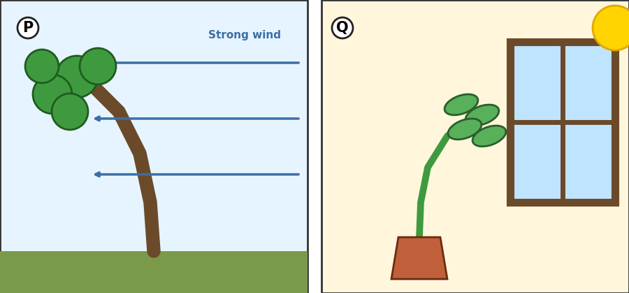
**Question:** Look at tree P. What kind of trait is its bent shape, and will its seeds grow into bent trees?
A) Inherited; yes
B) Acquired from the environment; no
C) Acquired through learning; yes
D) Inherited; no

**Hint:** Who bent the tree?
**Answer:** B
**Explanation:** The wind bent the tree, so the shape is acquired from the environment. Acquired physical traits are not passed to offspring.

### Q9 · MCQ · LP2 · Hard
**Question:** Layla learns to ride a bike. Which statement is correct?
A) It is an inherited behavior, so her children will be born knowing how to ride
B) It is a physical trait
C) It is an acquired trait from the environment, like tanning
D) It is an acquired trait learned by practice, so her children will also need to learn

**Hint:** How did she get the skill?
**Answer:** D
**Explanation:** Riding a bike is a behavior acquired through learning. It is not passed to offspring.

### Q10 · MCQ · LP3 · Medium
**Question:** Which one is a physical adaptation?
A) A snake's jaws that open wide to swallow food whole
B) A praying mantis making itself look bigger
C) A plant growing toward light
D) A frigate bird inflating its pouch

**Hint:** Physical adaptations are about body parts.
**Answer:** A
**Explanation:** Jaws are a body part. The others are behaviors (actions).

### Q11 · MCQ · LP3 · Medium
**Question:** Why are an owl's wings fringed?
A) To fly faster than other birds
B) To swim in the water
C) To fly silently and sneak up on prey
D) To store water

**Hint:** Think about catching a mouse at night.
**Answer:** C
**Explanation:** The fringed wings let owls fly in silence, so their prey does not hear them.

### Q12 · MCQ · LP3 · Hard
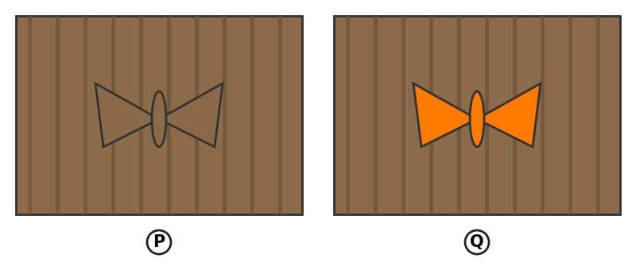
**Question:** Which moth is camouflaged against the bark?
A) Moth Q
B) Both moths
C) Neither moth
D) Moth P

**Hint:** Which moth is harder to see?
**Answer:** D
**Explanation:** Moth P has almost the same color as the bark, so it blends in. Moth Q is bright orange, so it is easy to see.

### Q13 · MCQ · LP5 · Hard

**Question:** Birds hunt moths on this tree. Over many generations, what is most likely to happen to the number of moths like Q?
A) Increase, because bright color attracts food
B) Decrease, because they are easily seen, so fewer survive and reproduce
C) Stay the same
D) All of them will change color by themselves

**Hint:** Which moths survive to reproduce?
**Answer:** B
**Explanation:** This is natural selection. The less adapted organisms are caught more often and leave fewer offspring.

### Q14 · MCQ · LP3 · Medium
**Question:** A harmless fly has stripes that make it look like a wasp, so predators stay away. This is an example of:
A) mimicry
B) camouflage
C) extinction
D) natural selection

**Hint:** The fly looks like *another organism*.
**Answer:** A
**Explanation:** In mimicry, an organism looks like another organism to frighten or fool predators.

### Q15 · MCQ · LP3 · Medium
**Question:** A cicada sits on a tree and is the same color as the bark. This is an example of:
A) mimicry
B) extinction
C) camouflage
D) an acquired trait

**Hint:** It *blends into* its environment.
**Answer:** C
**Explanation:** Camouflage helps an animal blend into its environment and avoid being seen.

### Q16 · MCQ · LP3 · Medium
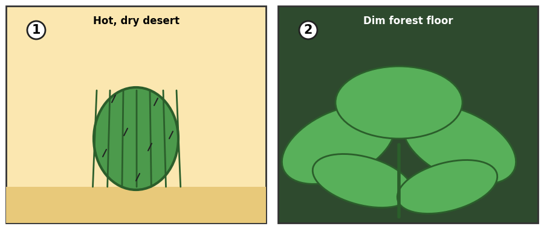
**Question:** What physical adaptation does plant 1 have, and how does it help?
A) Large leaves; they capture more sunlight
B) A thick, fleshy stem; it stores water
C) Parachute-like seeds; they travel far
D) Colorful petals; they guide insects

**Hint:** Plant 1 lives in a hot, dry desert.
**Answer:** B
**Explanation:** A barrel cactus has a thick, fleshy stem that stores water for dry times.

### Q17 · MCQ · LP3 · Medium

**Question:** Plant 2 grows on a dim forest floor. Which adaptation helps it most?
A) A fleshy stem to store water
B) Parachute-like seeds
C) Fringed wings
D) Large leaves to capture more sunlight

**Hint:** There is little light on the forest floor.
**Answer:** D
**Explanation:** Plants living in dim places have large leaves to capture more sunlight.

### Q18 · MCQ · LP3 · Medium
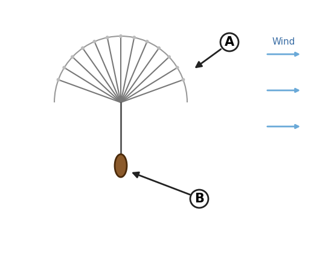
**Question:** What is the job of structure A?
A) It helps wind carry the seed to a new place
B) It stores water
C) It guides insects to the flower
D) It protects the seed from predators

**Hint:** Look at the wind arrows.
**Answer:** A
**Explanation:** The parachute-like structure lets the wind carry the seed over long distances to reach new areas.

### Q19 · MCQ · LP3 · Hard
**Question:** The markings on a pansy flower guide insects to it. How does this help the plant?
A) It helps the plant store water
B) It helps the plant hide from predators
C) Insects carry pollen between flowers, which helps the plant reproduce
D) It makes the plant's seeds bigger

**Hint:** Think about what the insect brings and takes.
**Answer:** C
**Explanation:** Insects feed on nectar and deposit pollen from other flowers. This helps plant reproduction.

### Q20 · MCQ · LP4 · Hard
**Question:** A male frigate bird has a red pouch that it inflates during the breeding season. Which statement is correct?
A) Both the pouch and the inflating are physical traits
B) Both the pouch and the inflating are behaviors
C) The pouch is a behavior; the inflating is a physical trait
D) The pouch is a physical trait; the inflating is a behavioral adaptation

**Hint:** A body part vs an action.
**Answer:** D
**Explanation:** The pouch is a body part (physical). Inflating it is an action (behavior) that helps him attract females.

### Q21 · MCQ · LP4 · Medium
**Question:** Which pair are BOTH behavioral adaptations?
A) Mimicry and camouflage
B) A plant growing toward light and a mantis making itself look bigger
C) An owl's wings and a cactus's stem
D) A snake's jaws and a mantis making itself look bigger

**Hint:** Behavior means "how an organism acts".
**Answer:** B
**Explanation:** Growing toward light and scaring enemies are actions. The other choices include body parts.

### Q22 · MCQ · LP5 · Hard
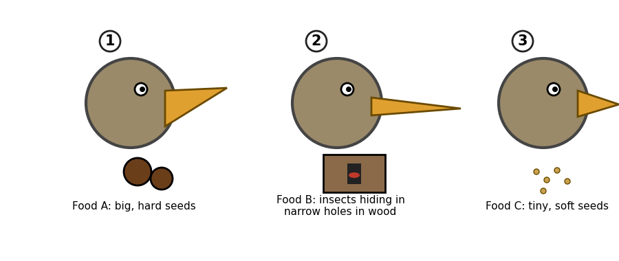
**Question:** Which bird is best adapted to eat Food B?
A) Bird 2
B) Bird 1
C) Bird 3
D) All birds are equally adapted

**Hint:** Food B is hidden in narrow holes.
**Answer:** A
**Explanation:** Bird 2's long, thin beak can reach into narrow holes. The beak shape is adapted to the food source.

### Q23 · MCQ · LP5 · Medium

**Question:** Bird 1 has a thick, strong beak. Which food can it eat most easily?
A) Food B
B) Food C
C) Food A
D) None

**Hint:** Which food needs a strong beak?
**Answer:** C
**Explanation:** A thick, strong beak can crack big, hard seeds.

### Q24 · MCQ · LP5 · Hard
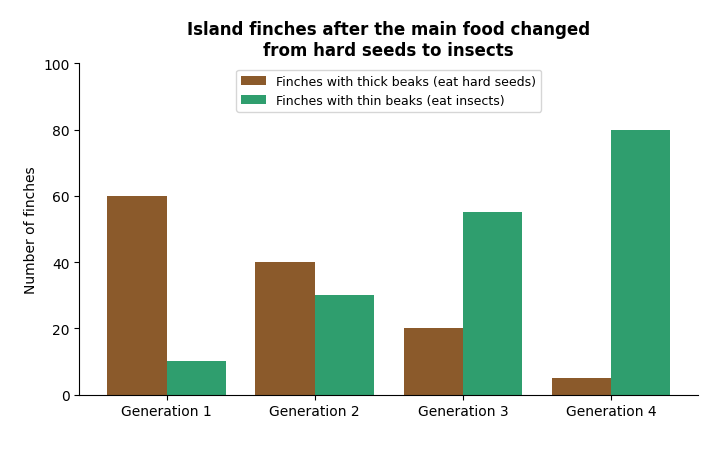
**Question:** What happened to the finches with thick beaks after the main food changed to insects?
A) Their number increased
B) Their number decreased, because their beaks no longer fit the main food
C) They changed into thin-beaked finches
D) Their number stayed the same

**Hint:** Look at the brown bars.
**Answer:** B
**Explanation:** The brown bars go down from 60 to 5. Finches that are less adapted to the new food do not survive and reproduce.

### Q25 · MCQ · LP5 · Hard

**Question:** The graph is an example of:
A) mimicry
B) extinction of the whole species
C) camouflage
D) natural selection

**Hint:** Which birds survive and reproduce?
**Answer:** D
**Explanation:** The finches best adapted to the new food (thin beaks) survive and reproduce. The thick-beaked finches are not yet extinct, since some are still alive.

### Q26 · MCQ · LP5 · Medium
**Question:** What did Darwin notice in the Galápagos Islands?
A) Finches on different islands had different beak shapes and ate different foods
B) Dinosaurs had sharp teeth
C) An asteroid hit the island
D) Giraffes had long necks

**Hint:** A bird famous for beaks.
**Answer:** A
**Explanation:** Darwin concluded that each group's beak shape was adapted to its food source.

### Q27 · MCQ · LP5 · Medium
**Question:** Natural selection is the process by which:
A) organisms choose to change their bodies
B) all organisms survive
C) organisms that are best adapted to their environment survive and reproduce
D) fossils are formed

**Hint:** "Selection" means being picked by the environment.
**Answer:** C
**Explanation:** Organisms less adapted do not survive and do not produce offspring.

### Q28 · MCQ · LP2 · Hard
**Question:** A bodybuilder has big muscles from exercise. Will his baby be born with big muscles because of this?
A) Yes, because muscles are inherited
B) Yes, because he practiced a lot
C) Only if the baby exercises
D) No, because acquired physical traits are not passed to offspring

**Hint:** Was the trait inherited or acquired?
**Answer:** D
**Explanation:** The big muscles were acquired by exercising. Acquired physical traits are not passed on.

### Q29 · MCQ · LP6 · Hard
**Question:** Only three members of a species are left alive in a zoo. Which statement is correct?
A) The species is extinct
B) The species is not extinct yet, because extinction means ALL members have disappeared
C) The species uses mimicry
D) The species uses camouflage

**Hint:** Look at the word "complete".
**Answer:** B
**Explanation:** Extinction is the complete disappearance of all members of a species.

### Q30 · MCQ · LP6 · Medium
**Question:** Which cause of extinction is slow?
A) The ice ages, which changed conditions slowly over hundreds or thousands of years
B) An asteroid striking Earth
C) A lightning strike
D) A single hunter

**Hint:** Woolly mammoths became extinct this way.
**Answer:** A
**Explanation:** The ice ages ended as conditions became gradually warmer. An asteroid is a rapid change.

### Q31 · MCQ · LP6 · Hard
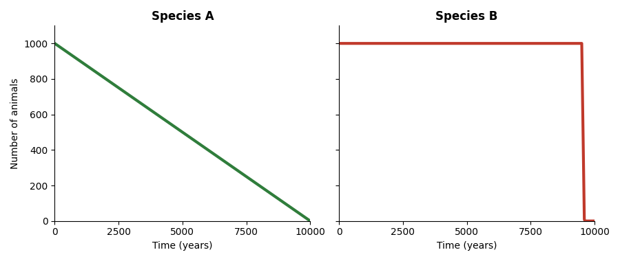
**Question:** Which species most likely suffered a rapid change, such as an asteroid strike?
A) Species A
B) Neither
C) Species B
D) Both

**Hint:** Look at how fast the line drops.
**Answer:** C
**Explanation:** Species B stays steady and then drops suddenly. Species A goes down slowly over thousands of years, like during an ice age.

### Q32 · MCQ · LP6 · Medium
**Question:** Which one is NOT a main human cause of extinction today?
A) Logging forests to build cities
B) Protecting habitats
C) Pollution
D) Massive hunting

**Hint:** Find the helpful action.
**Answer:** B
**Explanation:** Logging forests, pollution and massive hunting increase extinction. Protecting habitats helps species survive.

### Q33 · MCQ · LP7 · Medium
**Question:** Which one is a fossil?
A) The bone of a cow that died last week
B) A living fish in the sea
C) A dead tree in a forest
D) The footprint of an ancient animal preserved in rock

**Hint:** A fossil is "remains or traces" of an organism that lived *long ago*.
**Answer:** D
**Explanation:** A fossil is the remains or traces of an organism that lived long ago.

### Q34 · MCQ · LP7 · Hard
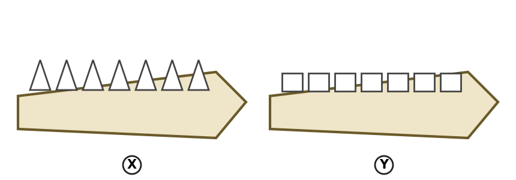
**Question:** Fossil X has sharp, pointed teeth. What can scientists infer?
A) This dinosaur ate meat
B) This dinosaur ate only plants
C) We cannot learn anything from it
D) This dinosaur was a fish

**Hint:** Sharp teeth are good for tearing.
**Answer:** A
**Explanation:** A fossil with sharp teeth shows that the dinosaur ate meat. (Fossil Y has flat teeth, which suggests a different diet.)

### Q35 · MCQ · LP7 · Hard
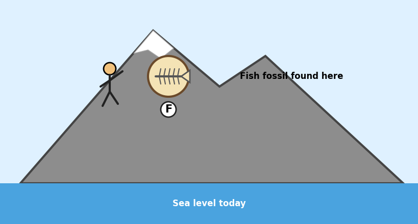
**Question:** The boy finds a fish fossil near the top of a mountain. What can he conclude?
A) The fish climbed the mountain
B) The fish is still alive
C) The mountain was once covered by the sea, and the fossil formed at the bottom of the sea
D) Someone must have brought the fossil there

**Hint:** Where do fish live?
**Answer:** C
**Explanation:** Fossils give clues about Earth's history. A fish lived in water, so the place was once under the sea.

### Q36 · MCQ · LP7 · Medium
**Question:** Why is amber helpful to scientists?
A) It contains living insects
B) It is a hard, fossilized resin that can trap insects, and even preserve their DNA
C) It is the skin of dinosaurs
D) It is a kind of rock made of fish

**Hint:** It is "fossilized resin".
**Answer:** B
**Explanation:** Scientists studied the DNA of a beetle 120–135 million years old that was trapped in amber.

---
## Part B – True or False (Q37–Q60)
*(If the statement is false, correct it.)*

### Q37 · True/False · LP1 · Medium
**Statement:** Most physical traits are inherited.
**Hint:** Think of the shape of an oak leaf.
**Answer:** True
**Explanation:** Offspring resemble their parents in most physical traits.

### Q38 · True/False · LP2 · Medium
**Statement:** Every trait of an organism is inherited.
**Hint:** What about a scar or a tan?
**Answer:** False
**Explanation:** Some traits are acquired through learning or from the environment.

### Q39 · True/False · LP2 · Medium
**Statement:** If a girl's skin becomes tanned at the beach, her children will be born with tanned skin.
**Hint:** Was the tan inherited or acquired?
**Answer:** False
**Explanation:** A tan is acquired from the environment (sunlight). Acquired physical traits are not passed to offspring.

### Q40 · True/False · LP2 · Medium
**Statement:** A dog that practices catching a flying disc shows an acquired trait learned by practice.
**Hint:** Practice = learning.
**Answer:** True
**Explanation:** Many behaviors are acquired through learning.

### Q41 · True/False · LP1 · Hard
**Statement:** Behaviors can only be acquired; they can never be inherited.
**Hint:** Think about baby sea turtles.
**Answer:** False
**Explanation:** Behaviors can be inherited too, such as baby turtles heading for the water.

### Q42 · True/False · LP2 · Medium
**Statement:** A plant's leaf turns brown from too much sun. The plant's offspring will not inherit brown leaves.
**Hint:** Cause of the brown color?
**Answer:** True
**Explanation:** Browning is acquired from the environment, so it is not passed to offspring.

### Q43 · True/False · LP3 · Medium
**Statement:** An adaptation can be a physical trait or a behavior.
**Hint:** Think of a cactus stem and a praying mantis.
**Answer:** True
**Explanation:** An adaptation is a trait or behavior that helps an organism survive in its environment.

### Q44 · True/False · LP3 · Medium
**Statement:** Camouflage and mimicry mean exactly the same thing.
**Hint:** Blending in vs looking like another organism.
**Answer:** False
**Explanation:** Camouflage helps an organism blend into its environment. Mimicry is when an organism looks like another organism.

### Q45 · True/False · LP3 · Medium
**Statement:** A barrel cactus's thick, fleshy stem stores water.
**Hint:** Think desert.
**Answer:** True
**Explanation:** Plants in dry environments have adaptations to store water.

### Q46 · True/False · LP3 · Medium
**Statement:** Only animals have adaptations; plants do not.
**Hint:** Think of a dandelion seed.
**Answer:** False
**Explanation:** Plants have physical adaptations (large leaves, parachute-like seeds) and behavioral adaptations (growing toward light).

### Q47 · True/False · LP4 · Medium
**Statement:** A houseplant that bends toward a window shows a behavioral adaptation.
**Hint:** Why does it bend?
**Answer:** True
**Explanation:** The behavior helps the plant collect more sunlight for photosynthesis and produce more food.

### Q48 · True/False · LP3 · Medium
**Statement:** The large leaves of plants on the forest floor help them store water.
**Hint:** Large leaves capture…?
**Answer:** False
**Explanation:** Large leaves help plants capture more sunlight in dim places. Cacti store water in their stems.

### Q49 · True/False · LP3 · Medium
**Statement:** The parachute-like structure of a dandelion seed helps the plant reproduce.
**Hint:** Wind carries it.
**Answer:** True
**Explanation:** The wind carries the seeds over long distances to new areas.

### Q50 · True/False · LP5 · Hard
**Statement:** In natural selection, each animal decides to change its body to fit the environment.
**Hint:** Who survives and reproduces?
**Answer:** False
**Explanation:** Organisms best adapted to their environment survive and reproduce. Animals do not choose to change.

### Q51 · True/False · LP5 · Medium
**Statement:** Darwin concluded that beak shape in finches was an adaptation to food source.
**Hint:** Galápagos Islands.
**Answer:** True
**Explanation:** He saw different beak shapes and different foods on each island.

### Q52 · True/False · LP5 · Hard
**Statement:** In natural selection, organisms that are less adapted survive and reproduce just as much as the best adapted ones.
**Hint:** Which ones leave offspring?
**Answer:** False
**Explanation:** Less adapted organisms do not survive and do not produce offspring.

### Q53 · True/False · LP6 · Medium
**Statement:** Extinction is the complete disappearance of all members of a species.
**Hint:** "Complete".
**Answer:** True
**Explanation:** This is the definition of extinction.

### Q54 · True/False · LP6 · Medium
**Statement:** Extinction always happens quickly.
**Hint:** The ice ages.
**Answer:** False
**Explanation:** Some changes happen slowly, over hundreds or thousands of years, and also lead to extinction.

### Q55 · True/False · LP6 · Medium
**Statement:** Human activities are increasing the rate of extinction today.
**Hint:** Logging, pollution, hunting.
**Answer:** True
**Explanation:** The current extinction rate is increasing because of human activities.

### Q56 · True/False · LP7 · Medium
**Statement:** A fossil is a living organism found in a rock.
**Hint:** "Long ago".
**Answer:** False
**Explanation:** A fossil is the remains or traces of an organism that lived long ago.

### Q57 · True/False · LP7 · Medium
**Statement:** A dinosaur fossil with sharp teeth shows that the dinosaur probably ate meat.
**Hint:** Look at the teeth.
**Answer:** True
**Explanation:** Fossils give clues about diet and how animals lived.

### Q58 · True/False · LP6 · Medium
**Statement:** Most scientists believe the dinosaurs became extinct because of the ice ages.
**Hint:** What struck Earth 65 million years ago?
**Answer:** False
**Explanation:** Most scientists believe an asteroid struck Earth. The ice ages caused the extinction of other species such as the woolly mammoth.

### Q59 · True/False · LP5 · Hard
**Statement:** Ocean fish placed in a freshwater home aquarium would survive, because adaptations help in any environment.
**Hint:** Salty water vs fresh water.
**Answer:** False
**Explanation:** Ocean fish are adapted to salty water. In fresh water they would die.

### Q60 · True/False · LP7 · Medium
**Statement:** An insect trapped in amber can become a fossil that scientists can study.
**Hint:** Amber is hard fossilized resin.
**Answer:** True
**Explanation:** Amber often contains trapped insects.

---

## Part C – Find the Mistake (Q61–Q80)
*(Find the mistake and write the correct answer.)*

### Q61 · Find the Mistake · LP2 · Medium
**Student's answer:** "Nadia's skin became tanned at the beach. Her tan is an inherited trait."
**Hint:** What caused the tan?
**Mistake:** The tan is not inherited.
**Correct answer:** A tan is an acquired trait from the environment.
**Explanation:** The sunlight caused the tan. Acquired physical traits are not passed to offspring.

### Q62 · Find the Mistake · LP5 · Hard
**Student's answer:** "When the food changed, the finches changed their beaks on purpose to eat the insects."
**Hint:** Who survives?
**Mistake:** Finches do not change on purpose.
**Correct answer:** Finches with beaks adapted to insects survived and reproduced. The others did not survive.
**Explanation:** This is natural selection.

### Q63 · Find the Mistake · LP4 · Medium
**Student's answer:** "A praying mantis making itself look bigger is a physical adaptation."
**Hint:** Is it a body part or an action?
**Mistake:** It is an action.
**Correct answer:** It is a behavioral adaptation.
**Explanation:** Behavior describes how an organism acts.

### Q64 · Find the Mistake · LP3 · Medium
**Student's answer:** "Camouflage means looking like another organism."
**Hint:** Which word means looking like another organism?
**Mistake:** The definition is for mimicry.
**Correct answer:** Camouflage helps an animal blend into its environment.
**Explanation:** Mimicry is when an organism looks like another organism.

### Q65 · Find the Mistake · LP6 · Hard
**Student's answer:** "A species is extinct when its number becomes very small."
**Hint:** Is "very small" the same as "none"?
**Mistake:** A small number is not extinction.
**Correct answer:** A species is extinct when all its members have disappeared.
**Explanation:** Extinction is the complete disappearance of all members.

### Q66 · Find the Mistake · LP6 · Medium
**Student's answer:** "Dinosaurs became extinct because of pollution and logging forests."
**Hint:** Dinosaurs lived 65 million years ago.
**Mistake:** Those are today's human causes.
**Correct answer:** Most scientists believe an asteroid struck Earth and changed the environment so much that dinosaurs could not adapt.
**Explanation:** Pollution, logging and hunting are the main causes of extinction today.

### Q67 · Find the Mistake · LP2 · Hard

**Student's answer:** "Tree P was bent by the wind. Its seeds will also grow into bent trees."
**Hint:** Is the bent shape inherited?
**Mistake:** The conclusion about the seeds.
**Correct answer:** The seeds will grow into straight trees, unless the wind bends them too.
**Explanation:** Bending from the wind is an acquired trait. It is not inherited.

### Q68 · Find the Mistake · LP1 · Medium
**Student's answer:** "A dog catching a flying disc is an inherited behavior."
**Hint:** Did the dog need practice?
**Mistake:** The behavior is learned.
**Correct answer:** It is an acquired behavior learned by practice.
**Explanation:** The dog learns by practicing again and again.

### Q69 · Find the Mistake · LP3 · Medium
**Student's answer:** "The parachute-like structure of a dandelion seed helps the plant store water."
**Hint:** What does wind do?
**Mistake:** The function is wrong.
**Correct answer:** It helps the wind carry the seeds far away, so the plant can reproduce in new areas.
**Explanation:** Water is stored in the stem of a cactus.

### Q70 · Find the Mistake · LP7 · Hard
**Student's answer:** "Fossils are only bones of animals."
**Hint:** Look at the definition: "remains or *traces*".
**Mistake:** Fossils are not only bones.
**Correct answer:** A fossil is the remains or traces of an organism that lived long ago (for example, an imprint, a footprint or an insect in amber).
**Explanation:** Plants and traces can be fossils too.

### Q71 · Find the Mistake · LP7 · Hard

**Student's answer:** "The fish fossil is on top of the mountain, so the fish climbed the mountain before it died."
**Hint:** Where do fish live?
**Mistake:** Fish cannot climb mountains.
**Correct answer:** The area was once covered by the sea, and the fish fossil formed at the bottom of the sea.
**Explanation:** Fossils give clues about Earth's history.

### Q72 · Find the Mistake · LP5 · Hard

**Student's answer:** "The graph shows that the finches with thick beaks increased because there were more insects."
**Hint:** Which bars go up?
**Mistake:** The thick-beaked finches decreased.
**Correct answer:** The thin-beaked finches increased because they can eat insects. The thick-beaked finches decreased.
**Explanation:** The bars for thick-beaked finches go down.

### Q73 · Find the Mistake · LP3 · Hard
**Student's table:**
| Physical adaptations | Behavioral adaptations |
|---|---|
| A snake's jaws | A praying mantis looking bigger |
| A cactus's thick stem | A frigate bird inflating its pouch |
| A plant growing toward light | |

**Hint:** Is growing toward light a body part or an action?
**Mistake:** "A plant growing toward light" is in the wrong column.
**Correct answer:** It is a behavioral adaptation.
**Explanation:** It is how the plant acts. It helps the plant collect more sunlight.

### Q74 · Find the Mistake · LP3 · Hard
**Student's answer:** "An owl's wings are fringed so it can fly faster than its prey."
**Hint:** Listen: what is the word "silent"?
**Mistake:** The function.
**Correct answer:** Fringed wings let owls fly silently and sneak up on prey.
**Explanation:** The adaptation is about silence.

### Q75 · Find the Mistake · LP4 · Hard
**Student's answer:** "A male frigate bird inflates his red pouch to scare away predators."
**Hint:** Think breeding season.
**Mistake:** The reason is wrong.
**Correct answer:** He inflates it to attract females during the breeding season.
**Explanation:** The praying mantis is the one that scares its enemies.

### Q76 · Find the Mistake · LP3 · Medium
**Student's answer:** "Cacti have large leaves to capture sunlight in dim places."
**Hint:** Cacti live in the desert.
**Mistake:** Cacti do not have large leaves for dim places.
**Correct answer:** Cacti have a thick, fleshy stem that stores water. Plants in dim places have large leaves.
**Explanation:** Different environments need different adaptations.

### Q77 · Find the Mistake · LP2 · Hard
**Student's answer:** "A dog fell and got a scar on its leg. Its puppies will be born with the same scar."
**Hint:** Inherited or acquired?
**Mistake:** The scar is not passed on.
**Correct answer:** The puppies will not have the scar.
**Explanation:** Acquired physical traits are not passed to offspring.

### Q78 · Find the Mistake · LP5 · Hard

**Student's answer:** "The orange moth Q is camouflaged, so it will survive better than moth P."
**Hint:** Which moth blends in?
**Mistake:** The moths are mixed up.
**Correct answer:** Moth P is camouflaged and will survive better. Moth Q is easy for predators to see.
**Explanation:** Camouflaged moths survive and reproduce more. This is natural selection.

### Q79 · Find the Mistake · LP6 · Hard

**Student's answer:** "Graph B shows a slow change like the ice ages."
**Hint:** Check how fast the line falls.
**Mistake:** Graph B drops quickly.
**Correct answer:** Graph A shows a slow change (like the ice ages). Graph B shows a rapid change (like an asteroid).
**Explanation:** Environmental changes can be slow or rapid.

### Q80 · Find the Mistake · LP5 · Hard
**Student's answer:** "Ocean fish are adapted to salty water, so they will live well in a freshwater aquarium."
**Hint:** Does adapted mean adapted to everything?
**Mistake:** The conclusion is wrong.
**Correct answer:** Ocean fish would die in fresh water, because they are adapted to salty water.
**Explanation:** An adaptation helps in a particular environment only.

---

## Part D – Written Questions (Q81–Q100)

### Q81 · Written · LP1 · Medium
**Question:** Define *inherited trait* and *acquired trait*. Give one example of each.
**Hint:** One is passed on; the other is picked up.
**Model answer:** An inherited trait is passed from parent to offspring (example: the shape of the earlobe or the color of a daisy). An acquired trait is picked up through learning or from the environment (example: tanned skin, or learning to ride a bike).
**Explanation:** The definition and one correct example for each.

### Q82 · Written · LP2 · Hard
**Question:** Sort these into *inherited* or *acquired*: (1) earlobe shape, (2) riding a bike, (3) a baby turtle crawling to the sea, (4) a sunburn, (5) number of legs of an insect, (6) speaking French, (7) a leaf browning in the sun, (8) flower color.
**Hint:** Ask: "Was it passed on, or picked up?"
**Model answer:** Inherited: 1, 3, 5, 8. Acquired: 2 and 6 (by learning); 4 and 7 (from the environment).
**Explanation:** Number 3 is an inherited *behavior*.

### Q83 · Written · LP2 · Hard
**Question:** Sam has curly hair. He also has a scar on his knee from a fall. (a) Which trait is inherited and which is acquired? (b) Will Sam's children have the scar? Explain.
**Hint:** Which one did he get from his parents?
**Model answer:** (a) Curly hair is inherited; the scar is acquired from the environment. (b) No, because acquired physical traits are not passed to offspring.
**Explanation:** Offspring resemble parents in inherited traits only.

### Q84 · Written · LP2 · Hard

**Question:** Both the tree (P) and the plant (Q) are bent. Are they the same kind of trait? Explain the difference.
**Hint:** Does the bending help the organism survive?
**Model answer:** No. The tree is bent by the wind, so it is an acquired trait from the environment. The plant bends toward the window on its own, which is a behavioral adaptation that helps it collect more sunlight for photosynthesis.
**Explanation:** Adaptations help the organism survive and reproduce. The wind's effect on the tree does not help it.

### Q85 · Written · LP3/LP4 · Hard
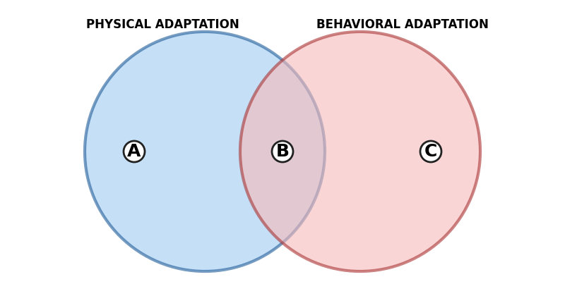
**Question:** Write the number of each statement in the correct region (A, B or C): (1) A lizard's color blends with the rocks. (2) A mantis makes itself look bigger. (3) It helps the organism survive and reproduce. (4) An owl's fringed wings make no noise. (5) A plant grows toward the light.
**Hint:** A = only physical, C = only behavioral, B = both.
**Model answer:** A (physical only): 1 and 4. C (behavioral only): 2 and 5. B (both): 3.
**Explanation:** Physical adaptations are body parts; behavioral adaptations are actions. Both kinds are adaptations because they help organisms survive and reproduce.

### Q86 · Written · LP3 · Hard
**Question:** Explain the difference between camouflage and mimicry. Give one example of each.
**Hint:** Blending in vs looking like another organism.
**Model answer:** Camouflage helps an animal blend into its environment (a lizard on a rock). Mimicry is when an organism looks like another organism (an insect that looks like a leaf, or a caterpillar that looks like a snake). Both help organisms avoid being eaten.
**Explanation:** Each has a different way of looking "hidden".

### Q87 · Written · LP3 · Hard
**Question:** Describe two physical adaptations that help plants reproduce, and explain how each one works.
**Hint:** One uses wind; one uses insects.
**Model answer:** (1) A dandelion seed has a parachute-like structure. The wind carries the seed far away to new places. (2) A pansy has markings on its petals that guide insects to the flower. The insects carry pollen from flower to flower.
**Explanation:** Adaptations help plants reproduce, not only survive.

### Q88 · Written · LP3 · Medium

**Question:** Plant 1 lives in a hot, dry desert and plant 2 lives on a dim forest floor. Write one physical adaptation for each, and say how it helps.
**Hint:** One stores water; one captures sunlight.
**Model answer:** Plant 1 has a thick, fleshy stem that stores water. Plant 2 has large leaves that capture more sunlight.
**Explanation:** Each environment needs a different adaptation.

### Q89 · Written · LP5 · Hard

**Question:** Use the graph. (a) What happened to the two groups of finches? (b) Explain why. (c) Which idea does this show?
**Hint:** Which beak fits the new food?
**Model answer:** (a) The thick-beaked finches decreased and the thin-beaked finches increased. (b) The main food changed to insects, so finches with thin beaks could get food, survive and reproduce. (c) Natural selection.
**Explanation:** The best-adapted organisms survive and reproduce.

### Q90 · Written · LP5 · Medium
**Question:** What did Darwin observe on the Galápagos Islands, and what did he conclude?
**Hint:** Beaks and food.
**Model answer:** He observed that finches on different islands had different beak shapes and ate different foods. He concluded that beak shape is an adaptation to the food source.
**Explanation:** This led to the idea of natural selection.

### Q91 · Written · LP5 · Hard
**Question:** In a snowy field, there are white rabbits and brown rabbits. Foxes hunt the rabbits. Explain what will probably happen over many generations. Use the words *adapted*, *survive* and *reproduce*.
**Hint:** Which rabbits are harder to see in snow?
**Model answer:** White rabbits are camouflaged in the snow, so they are better adapted. They survive more often and reproduce, so there will be more white rabbits in each generation. Brown rabbits are easy to see, so fewer survive and reproduce. This is natural selection.
**Explanation:** The environment "selects" the traits that help survival.

### Q92 · Written · LP6 · Medium
**Question:** What is extinction? Give one example of a slow cause and one example of a rapid cause.
**Hint:** Ice ages vs an asteroid.
**Model answer:** Extinction is the complete disappearance of all members of a species. Slow cause: the ice ages (many species, like woolly mammoths, disappeared as conditions changed slowly). Rapid cause: an asteroid striking Earth (dinosaurs).
**Explanation:** The species cannot adapt to the new conditions.

### Q93 · Written · LP6 · Medium
**Question:** Write three human activities that increase extinction today and explain how one of them can lead to extinction.
**Hint:** Logging, pollution, hunting.
**Model answer:** Logging forests, pollution and massive hunting. For example, when forests are cut down to build houses and cities, animals lose their habitat and cannot meet their needs.
**Explanation:** Antelopes are at risk because they are hunted by humans.

### Q94 · Written · LP7 · Hard

**Question:** Scientists find fossils X and Y. (a) What can they learn from fossil X? (b) Why are fossils the main way to study dinosaurs?
**Hint:** Dinosaurs are extinct.
**Model answer:** (a) Fossil X has sharp teeth, so the dinosaur probably ate meat. (b) Dinosaurs are extinct, so the only way to learn about their size, diet and movement is to study their fossils.
**Explanation:** Fossils give clues about how extinct organisms lived.

### Q95 · Written · LP7 · Hard

**Question:** Explain how a fish fossil can be found near the top of a mountain, far from the sea.
**Hint:** Think about long ago.
**Model answer:** Long ago, this area was covered by the sea. The fish died and became a fossil at the bottom of the sea. Later, the land changed and the rock became a mountain. Fossils give clues about Earth's history.
**Explanation:** Fossils help scientists learn how Earth has changed over time.

### Q96 · Written · LP7 · Hard
**Question:** In 1993, scientists studied the DNA of a beetle trapped in amber for 120–135 million years. What is amber, and why is it useful?
**Hint:** Hard, fossilized resin.
**Model answer:** Amber is a hard, fossilized resin that often contains trapped insects. It preserves the insects, so scientists can study organisms that lived millions of years ago.
**Explanation:** Fossils provide clues about extinct species.

### Q97 · Written · LP5 · Hard
**Question:** Ocean fish are placed in a freshwater aquarium at home. Predict what will happen and explain.
**Hint:** Adapted to what kind of water?
**Model answer:** The fish would die, because they are adapted to salty water and cannot meet their needs in fresh water.
**Explanation:** An adaptation works in a specific environment.

### Q98 · Written · LP3/LP4 · Hard
**Question:** A mouse is hunted by an owl. Name one physical adaptation and one behavioral adaptation that could help the mouse escape.
**Hint:** Body part vs action.
**Model answer:** Physical: fur that blends with the background (camouflage), or good hearing or vision. Behavioral: freezing or hiding when it senses the owl.
**Explanation:** Both kinds of adaptations help the mouse survive.

### Q99 · Written · LP2 · Medium
**Question:** The ability to ride a bike: what type of trait is it? How is it gained? Will a child of a person who rides a bike be born knowing how to ride?
**Hint:** Think about how you learned.
**Model answer:** It is an acquired trait, gained through learning (practice). No, the child will have to learn it too.
**Explanation:** Acquired traits are not passed to offspring.

### Q100 · Written · LP3/LP4 · Hard
**Question:** Complete the table.
| Organism | Adaptation | Physical or behavioral? | How it helps |
|---|---|---|---|
| Owl | Fringed wings | (a) | (b) |
| Praying mantis | Makes itself look bigger | (c) | (d) |
| Barrel cactus | (e) | Physical | Stores water |
| Houseplant near a window | Grows toward the light | (f) | (g) |

**Hint:** Decide if it is a body part or an action.
**Model answer:** (a) Physical (b) It flies silently and sneaks up on prey. (c) Behavioral (d) It frightens its enemies. (e) A thick, fleshy stem. (f) Behavioral (g) It collects more sunlight for photosynthesis, so it makes more food.
**Explanation:** Every adaptation helps the organism survive or reproduce.

---

*End of the question bank.*
